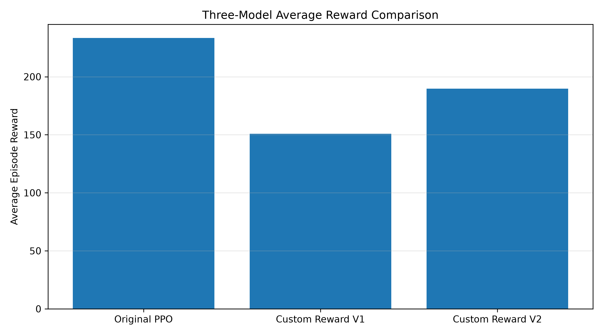
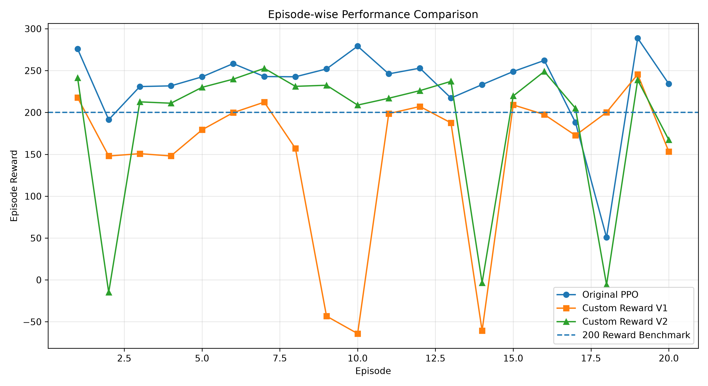
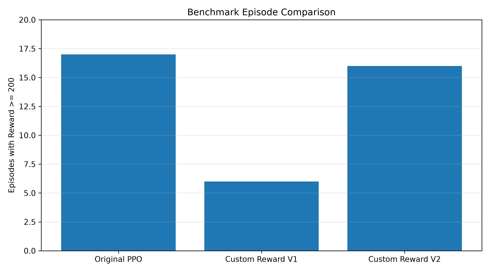

# PPO-Based Autonomous Landing Control

An autonomous rocket landing simulation using **Proximal Policy Optimization (PPO)** and Reinforcement Learning in Gymnasium's LunarLander-v3 environment.

This project explores how an AI agent learns to control a lunar lander through trial and error. It also investigates how custom reward shaping influences the agent's landing performance.

## Project Overview

The objective is to train an AI agent that can safely land a lunar lander by controlling its main engine and side engines.

The agent observes the environment, selects actions, receives rewards or penalties, and gradually improves its landing strategy through reinforcement learning.

**Environment:** Gymnasium LunarLander-v3  
**Algorithm:** Proximal Policy Optimization (PPO)  
**Framework:** Stable-Baselines3  
**Language:** Python  
**Training Device:** CPU

## Objectives

- Build an autonomous landing agent using Reinforcement Learning.
- Train a baseline PPO model.
- Implement custom reward shaping techniques.
- Compare different reward functions under the same evaluation conditions.
- Analyze how reward design affects learning performance.

## Technologies Used

| Technology | Purpose |
|---|---|
| Python | Programming language |
| Gymnasium | Reinforcement learning environment |
| Stable-Baselines3 | PPO implementation |
| PyTorch | Deep learning framework |
| NumPy | Numerical operations |
| Matplotlib | Performance visualization |
| Box2D | Lunar lander physics simulation |

## How the System Works

The project follows a reinforcement learning cycle:

1. The agent observes the lander's current state.
2. The PPO policy selects an action.
3. The environment executes the action.
4. The agent receives a reward based on its performance.
5. The policy updates to improve future decisions.

### Reinforcement Learning Workflow

```text
       Environment
      (LunarLander)
            |
            v
      Observe State
            |
            v
       PPO Agent
            |
            v
      Select Action
            |
            v
     Execute Action
            |
            v
     Receive Reward
            |
            v
     Update Policy
            |
            v
       Repeat Cycle
```

## Environment Details

The LunarLander-v3 environment provides an eight-dimensional observation space.

| Observation | Description |
|---|---|
| x | Horizontal position |
| y | Vertical position |
| vx | Horizontal velocity |
| vy | Vertical velocity |
| Angle | Lander orientation |
| Angular Velocity | Rotational speed |
| Left Leg Contact | Left landing leg contact |
| Right Leg Contact | Right landing leg contact |

The agent has four possible discrete actions:

| Action | Description |
|---|---|
| 0 | Do nothing |
| 1 | Fire left orientation engine |
| 2 | Fire main engine |
| 3 | Fire right orientation engine |

## Model Development

Three PPO models were developed and evaluated.

### 1. Original PPO Model

The first model uses the standard LunarLander-v3 reward function without additional reward shaping.

**Training configuration:**

- Algorithm: PPO
- Learning Rate: 0.0003
- Timesteps: 500,000
- Batch Size: 64
- Steps per Update: 2048
- Discount Factor: 0.99
- Device: CPU

This model acts as the baseline for comparing custom reward functions.

### 2. Custom Reward V1

The first custom reward experiment introduces potential-based reward shaping.

The potential function considers:

- Horizontal position
- Horizontal velocity
- Vertical velocity
- Lander angle
- Angular velocity

The potential function is:

\[
\Phi(s)=-\left(
|x|+0.5|v_x|+0.5|v_y|+
0.3|\theta|+0.1|\omega|
\right)
\]

The shaping reward is calculated as:

\[
F(s,s')=\gamma\Phi(s')-\Phi(s)
\]

The final reward becomes:

\[
R'=R+F(s,s')
\]

The purpose is to encourage the agent to move towards a more stable landing state.

### 3. Custom Reward V2

The second experiment improves the potential function by introducing vertical position and landing-leg contact information.

The potential function is:

\[
\Phi(s)=-E(s)+L(s)
\]

Where:

\[
E(s)=|x|+0.5|y|+0.5|v_x|+
0.5|v_y|+0.3|\theta|+0.1|\omega|
\]

And:

\[
L(s)=0.5(\text{Left Leg}+\text{Right Leg})
\]

The shaping reward remains:

\[
F(s,s')=\gamma\Phi(s')-\Phi(s)
\]

The final reward is:

\[
R'=R+F(s,s')
\]

This experiment investigates whether including additional state information can improve the agent's learning performance.

**Note:** The leg-contact bonus is a simple shaping signal. It does not independently guarantee a safe landing.

## Experimental Evaluation

All three models were evaluated over 20 episodes using identical environment reset seeds.

The evaluation used the original LunarLander-v3 environment reward, allowing the models to be compared using the same reward scale.

### Performance Results

| Model | Average Reward | Standard Deviation | Episodes >= 200 |
|---|---:|---:|---:|
| Original PPO | 233.48 | 48.61 | 17/20 |
| Custom Reward V1 | 150.79 | 90.65 | 6/20 |
| Custom Reward V2 | 189.78 | 85.14 | 16/20 |

### Average Reward Comparison



### Episode-wise Performance Comparison



### Benchmark Comparison



## Experimental Analysis

### Original PPO

- Achieved the highest average reward of 233.48.
- Reached the 200 reward benchmark in 17 out of 20 episodes.
- Demonstrated the most consistent performance among the three models.

### Custom Reward V1

- Achieved an average reward of 150.79.
- Reached the 200 reward benchmark in 6 out of 20 episodes.
- Had the highest performance variability.

### Custom Reward V2

- Achieved an average reward of 189.78.
- Improved considerably compared with Custom Reward V1.
- Reached the 200 reward benchmark in 16 out of 20 episodes.
- Still did not outperform the original PPO model in average reward.

## Experimental Conclusion

The experiments show that reward shaping can significantly influence reinforcement learning performance.

Custom Reward V2 performed better than Custom Reward V1, increasing the average reward from 150.79 to 189.78.

However, the original PPO model achieved the highest average reward of 233.48.

This demonstrates an important reinforcement learning concept:

**A more complex reward function does not automatically produce a better policy.**

Reward shaping must be carefully designed and evaluated to ensure that additional incentives help rather than interfere with the agent's learning process.

The results are based on one training run per model and 20 evaluation episodes, so further experiments with multiple training seeds are needed to establish more general conclusions.

## Project Structure

```text
PPO-Based-Autonomous-Landing-Control/
│
├── main.py
├── train.py
├── evaluate.py
├── record_video.py
│
├── train_original.py
├── evaluate_original.py
│
├── custom_env.py
├── train_custom.py
│
├── custom_env_v2.py
├── train_custom_v2.py
│
├── compare_models.py
├── compare_all_models.py
├── plot_comparison.py
├── plot_all_models.py
│
├── results/
│   ├── three_model_average_reward.png
│   ├── three_model_episode_comparison.png
│   └── benchmark_comparison.png
│
├── models/
├── videos/
├── requirements.txt
├── .gitignore
└── README.md
```

## Installation and Setup

### 1. Clone the Repository

```bash
git clone https://github.com/bharghavguru/PPO-Based-Autonomous-Landing-Control.git
```

```bash
cd PPO-Based-Autonomous-Landing-Control
```

### 2. Create a Virtual Environment

```bash
python -m venv venv
```

### 3. Activate the Environment

**Windows PowerShell:**

```powershell
.\venv\Scripts\Activate.ps1
```

### 4. Install Dependencies

```bash
pip install -r requirements.txt
```

### 5. Train the Original PPO Model

```bash
python train.py
```

### 6. Train Custom Reward V1

```bash
python train_custom.py
```

### 7. Train Custom Reward V2

```bash
python train_custom_v2.py
```

### 8. Compare All Models

```bash
python compare_all_models.py
```

### 9. Generate Performance Graphs

```bash
python plot_all_models.py
```

## Future Improvements

- Experiment with improved reward shaping strategies.
- Evaluate models using multiple training seeds.
- Analyze successful landings and crash rates separately.
- Improve landing stability and fuel efficiency.
- Experiment with different PPO hyperparameters.
- Explore alternative reinforcement learning algorithms.

## Author

**P.G.Gurubharghav**

Third-Year Computer Science and Engineering Student

GitHub: [bharghavguru](https://github.com/bharghavguru)

---

*This project is developed as a practical exploration of Reinforcement Learning, PPO, reward shaping, and autonomous control systems.*