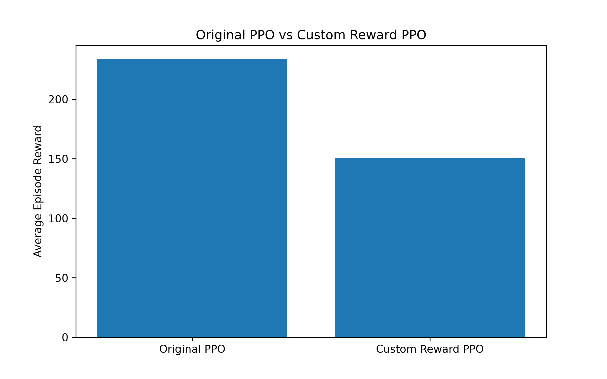
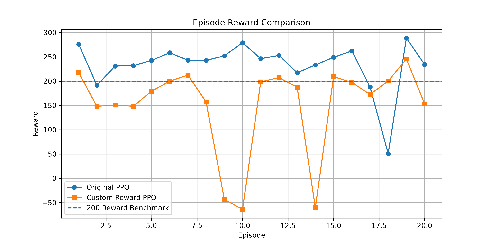

# 🚀 AI Rocket Landing Simulator

An AI-powered rocket landing simulator built using **Reinforcement Learning (PPO)** and Gymnasium's LunarLander environment.

This project explores how an AI agent learns to control a rocket, manage its movement, and achieve a safe landing through trial and error.

The project also experiments with **Custom Reward Shaping** to understand how reward design influences an AI agent's learning and performance.

## 🎯 Project Objectives

- Understand Reinforcement Learning through a practical simulation.
- Train an AI agent using Proximal Policy Optimization (PPO).
- Learn how an agent interacts with an environment through observations, actions, and rewards.
- Implement custom reward shaping.
- Compare the performance of original and custom-reward PPO models.
- Visualize and analyze experimental results.

## 🛠️ Technologies Used

- Python
- Gymnasium
- Stable-Baselines3
- PyTorch
- Matplotlib
- Proximal Policy Optimization (PPO)

## 🧠 How It Works

The project uses the LunarLander-v3 environment from Gymnasium.

The AI agent receives observations about the rocket's state and selects actions to control its movement.

**Observation space includes:**
- Horizontal position
- Vertical position
- Horizontal velocity
- Vertical velocity
- Rocket angle
- Angular velocity
- Left leg contact
- Right leg contact

**Available actions:**
- Do nothing
- Fire left engine
- Fire main engine
- Fire right engine

The PPO algorithm learns an effective landing strategy by interacting with the environment and receiving rewards.

## 🏗️ Project Architecture

```text
             LunarLander Environment
                       |
                       v
                AI Agent (PPO)
                       |
                       v
                 Observations
                       |
                       v
                Policy Network
                       |
                       v
                 Select Action
                       |
                       v
              Execute Rocket Action
                       |
                       v
                 Receive Reward
                       |
                       v
                Update PPO Policy
                       |
                       v
                 Repeat Training
```

## 🧪 Experiments

### Experiment 1: Original PPO

- Environment: LunarLander-v3
- Algorithm: PPO
- Policy: MlpPolicy
- Learning rate: 0.0003
- Training timesteps: 500,000
- Evaluation episodes: 20

### Experiment 2: Custom Reward Shaping

A custom Gymnasium reward wrapper was implemented using potential-based reward shaping.

The shaping function considers:

- Horizontal position
- Horizontal velocity
- Vertical velocity
- Rocket angle
- Angular velocity

The original environment reward is retained and combined with the additional shaping reward.

## 📊 Experimental Results

Both models were evaluated using the original LunarLander environment over 20 episodes.

| Metric | Original PPO | Custom Reward PPO |
|---|---:|---:|
| Average reward | 233.48 | 150.79 |
| Episodes with reward ≥ 200 | 17/20 | 6/20 |
| Threshold success rate | 85% | 30% |

### Average Reward Comparison



### Episode-wise Reward Comparison



### Key Observation

The original PPO model performed better than the custom reward model in this experiment.

This demonstrates that custom reward shaping does not automatically improve an agent's performance. Reward functions must be carefully designed and experimentally evaluated.

**Note:** An episode reward of 200 or more is used here as a benchmark, not as a direct measurement of physically verified safe landings.

## 📁 Project Structure

```text
AI-Rocket-Landing/
│
├── main.py
├── train.py
├── evaluate.py
├── record_video.py
│
├── custom_env.py
├── train_custom.py
├── compare_models.py
├── plot_comparison.py
│
├── results/
│   ├── average_reward.png
│   └── episode_comparison.png
│
├── models/
├── videos/
│
├── requirements.txt
├── .gitignore
└── README.md
```

## ⚙️ Installation and Setup

### 1. Clone the repository

```bash
git clone https://github.com/bharghavguru/AI-Rocket-Landing.git
cd AI-Rocket-Landing
```

### 2. Create a virtual environment

```bash
python -m venv venv
```

### 3. Activate the environment

Windows:

```powershell
.\venv\Scripts\activate
```

### 4. Install dependencies

```bash
pip install -r requirements.txt
```

### 5. Run the random baseline

```bash
python main.py
```

### 6. Train the original PPO model

```bash
python train.py
```

### 7. Evaluate the original model

```bash
python evaluate.py
```

### 8. Train the custom reward model

```bash
python train_custom.py
```

### 9. Compare both models

```bash
python compare_models.py
```

### 10. Generate result graphs

```bash
pip install matplotlib
python plot_comparison.py
```

**Note:** The trained model files are not included in the repository. Run the training scripts to generate them before evaluation. 

## 🔮 Future Improvements

- Improve custom reward function design.
- Experiment with different PPO hyperparameters.
- Compare multiple reward shaping strategies.
- Analyze landing success and crash rates separately.
- Visualize the agent's landing behavior.
- Explore additional Reinforcement Learning algorithms.

## 📚 Learning Outcomes

Through this project, I explored:

- Reinforcement Learning fundamentals.
- Environment and agent interaction.
- PPO algorithm and policy networks.
- Reward functions and reward shaping.
- Model training and evaluation.
- Experimental comparison and visualization.

## 👨‍💻 Author

**P.G.Gurubharghav**

BE Computer Science and Engineering

GitHub: [@bharghavguru](https://github.com/bharghavguru)

---

*Built as a hands-on learning project to explore Reinforcement Learning and AI through rocket landing simulation.*